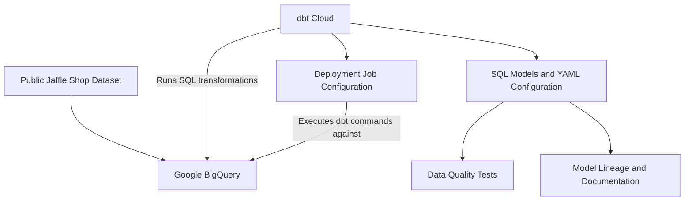

# ☁️ Cloud ELT Pipeline with dbt Cloud & Google BigQuery


A screenshot-documented portfolio project demonstrating a cloud **ELT (Extract, Load, Transform)** workflow using **Google BigQuery**, **dbt Cloud**, **SQL**, and **YAML**. The exercise explores SQL-based models, data quality tests, lineage, documentation, and deployment-job setup using the public **Jaffle Shop** tutorial dataset.

> **Project status — Archived demonstration:** The original dbt SQL models, YAML files, and cloud environment are no longer available. This repository preserves screenshots and implementation notes rather than an executable dbt project. No Power BI report was developed for this exercise.

## 📑 Table of Contents
- [Project Overview](#-project-overview)
- [Architecture](#️-architecture)
- [Technology Stack](#️-technology-stack)
- [Implementation Walkthrough](#-implementation-walkthrough)
- [Data Quality Tests](#-data-quality-tests)
- [Model Lineage and Documentation](#-model-lineage-and-documentation)
- [Deployment Workflow](#-deployment-workflow)
- [Screenshots](#-screenshots)
- [Project Availability](#-project-availability)
- [Key Learnings](#-key-learnings)

## 🎯 Project Overview

The objective was to learn how dbt can transform data already loaded into a cloud warehouse and make the resulting models easier to test, understand, and maintain.

The exercise covered setting up a Google Cloud project, accessing a public BigQuery dataset, connecting dbt Cloud to BigQuery, building SQL models, defining schema tests, exploring model dependencies, generating documentation, and configuring a deployment job.

## 🏗️ Architecture



**ELT vs. ETL:** BigQuery holds the source data, while dbt runs SQL transformations within the warehouse. No separate raw-file ingestion process is documented in this project.

## ⚙️ Technology Stack

| Technology | Role |
|---|---|
| Google Cloud Platform | Cloud project and service account setup |
| Google BigQuery | Source dataset and warehouse for transformed models |
| dbt Cloud | Model development, testing, documentation, and job configuration |
| SQL | Data selection and transformation logic |
| YAML | Model descriptions, tests, and project configuration |

## 🔧 Implementation Walkthrough

### 1. Configure Google Cloud and BigQuery

The exercise began with a Google Cloud project and service account to enable dbt Cloud to connect to BigQuery. The public Jaffle Shop tutorial data provided the sample source.


### 2. Connect dbt Cloud

A dbt Cloud environment was configured to work with the BigQuery warehouse using service-account credentials.


> **Security note:** Credentials and service-account private keys should never be committed to a public repository. Screenshots should be reviewed for sensitive configuration values before publication.

### 3. Build a SQL model

A sample query used the public customer dataset:

```sql
select *
from `dbt-tutorial.jaffle_shop.customers`
```

In dbt, a model is typically a `.sql` file containing a `SELECT` statement. dbt compiles and runs the model in the target warehouse.


### 4. Explore materializations

The project explored how dbt models can be materialized as warehouse views or tables. Materialization can be configured in model SQL or in `dbt_project.yml`; model documentation and tests are commonly declared in YAML property files.


## ✅ Data Quality Tests

The original project notes show schema-test examples for customers and orders, including:

| Test | Purpose |
|---|---|
| `unique` | Ensure identifiers do not repeat |
| `not_null` | Require values in key columns |
| `accepted_values` | Restrict order statuses to approved values |
| `relationships` | Check order customer IDs against the referenced customer model |

Illustrative excerpt reconstructed from the original README (not a recovered project file):

```yaml
version: 2

models:
  - name: stg_customers
    description: This model cleans up customer data
    columns:
      - name: customer_id
        tests:
          - unique
          - not_null

  - name: stg_orders
    description: This model cleans up order data
    columns:
      - name: order_id
        tests:
          - unique
          - not_null
      - name: status
        tests:
          - accepted_values:
              values: ['placed', 'shipped', 'completed', 'return_pending', 'returned']
      - name: customer_id
        tests:
          - not_null
          - relationships:
              to: ref('stg_customers')
              field: customer_id
```


The screenshots document testing activity; detailed historical test logs and pass/fail totals are not available.

## 🔗 Model Lineage and Documentation

The dbt DAG visualizes model dependencies, making upstream and downstream relationships easier to inspect.


Model and column descriptions support maintainability and knowledge sharing.


## 🚀 Deployment Workflow

The exercise also explored configuring and triggering dbt Cloud deployment jobs to rerun models as source data changes. The original job definitions, schedule, and historical execution logs are not retained, so this repository does not claim a currently running production schedule.


## 📸 Screenshots

The screenshots embedded throughout this README cover cloud setup, dbt connection, model development, materialization, testing, lineage, documentation, and deployment. Images are hosted as GitHub user attachments and are preserved from the original project documentation.

## 📂 Project Availability

This is an **archived technical portfolio walkthrough**, not a reproducible source-code repository. The original `.sql` models, `.yml` configuration files, cloud credentials, and dbt environment are unavailable. The example SQL and YAML above illustrate concepts recorded in the original README; they are not presented as a complete executable project.

To reproduce the exercise, create a new BigQuery and dbt environment, configure access to the public Jaffle Shop dataset, implement the models and tests, and set up a deployment job using current dbt documentation.

## 💡 Key Learnings

- Differentiating warehouse-based **ELT** from traditional ETL.
- Building reusable SQL transformation models in dbt Cloud.
- Applying uniqueness, completeness, accepted-value, and relationship tests.
- Understanding model lineage through dependency graphs.
- Documenting models and columns for maintainability.
- Exploring deployment-job configuration for repeatable warehouse transformations.

**Portfolio focus:** This project documents foundational cloud data engineering practices and complements hands-on BI reporting and traditional SSIS ETL projects.
